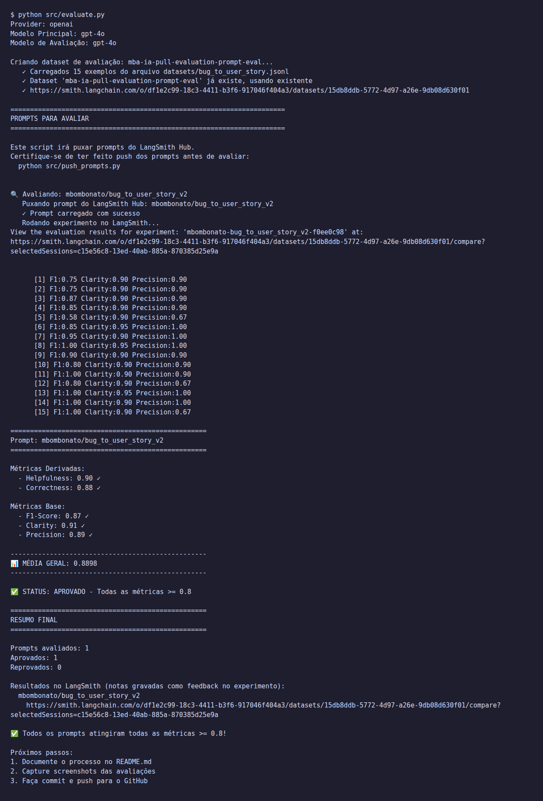
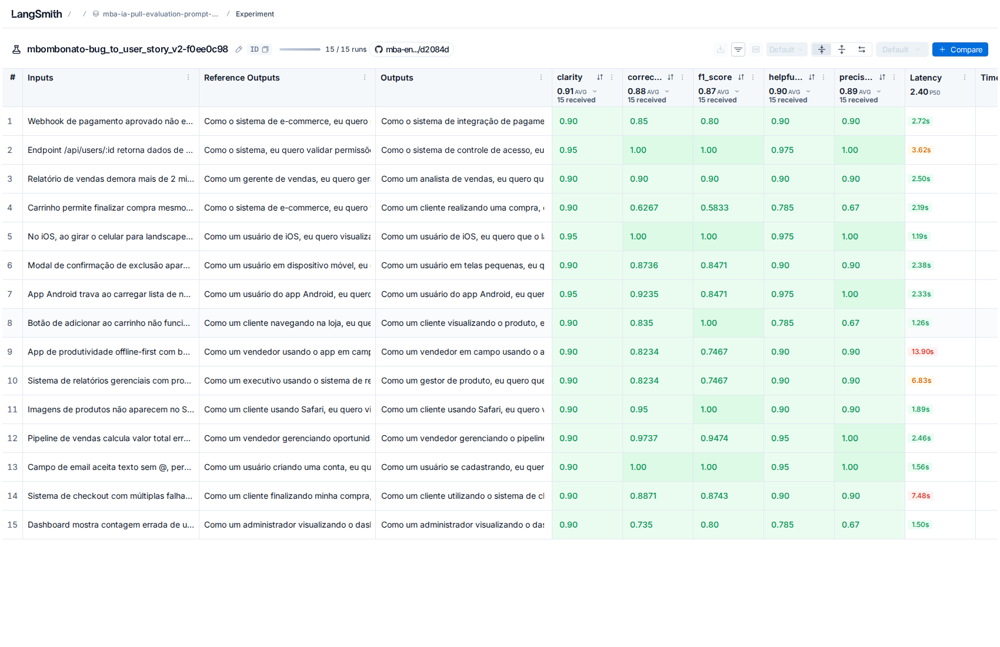
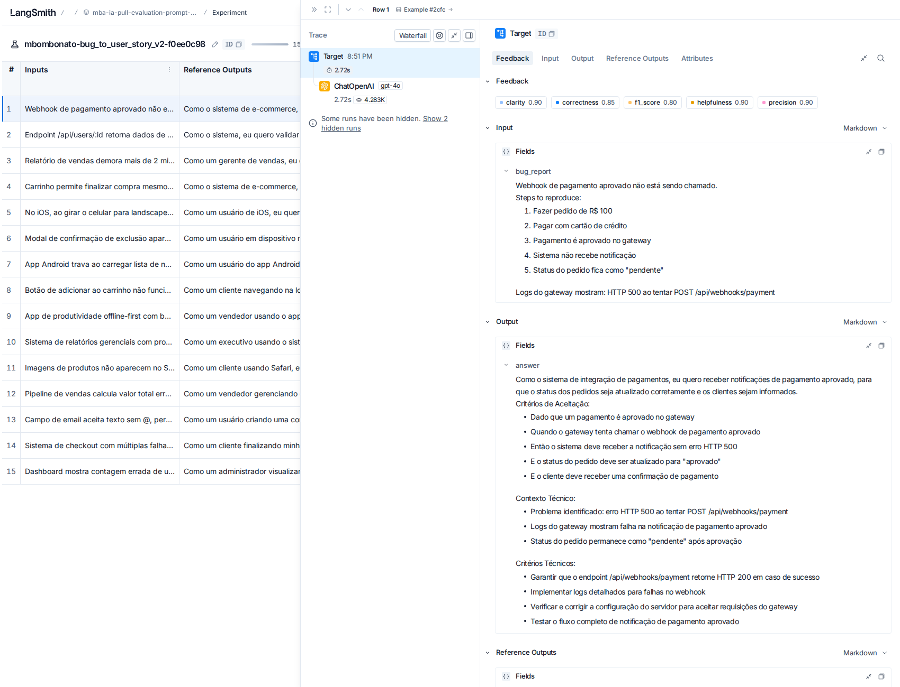
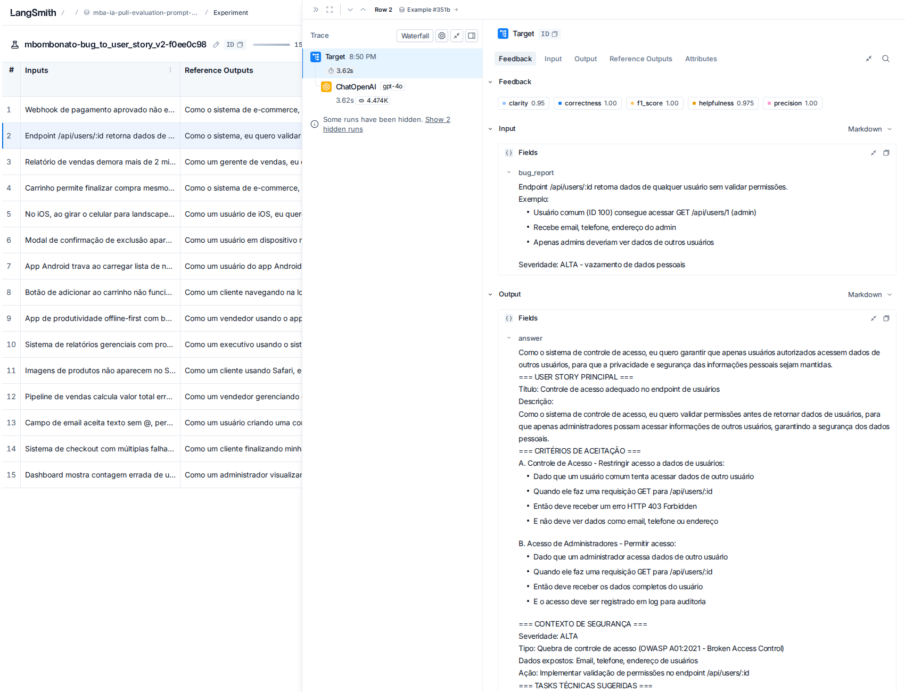
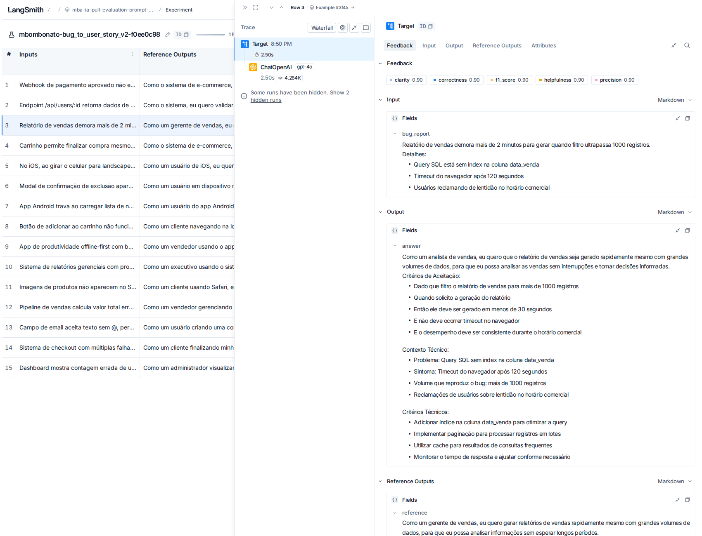
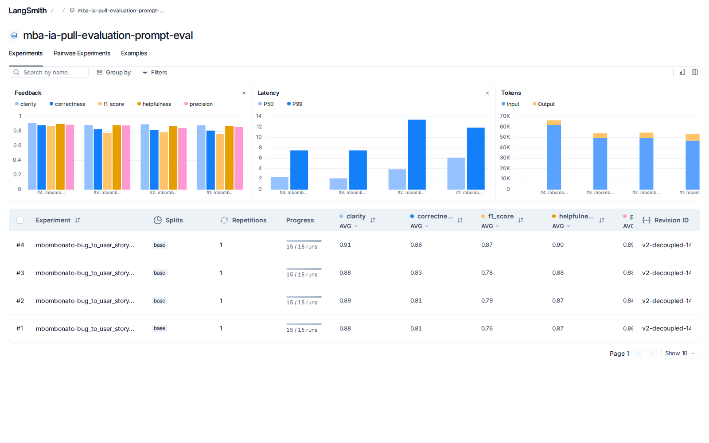
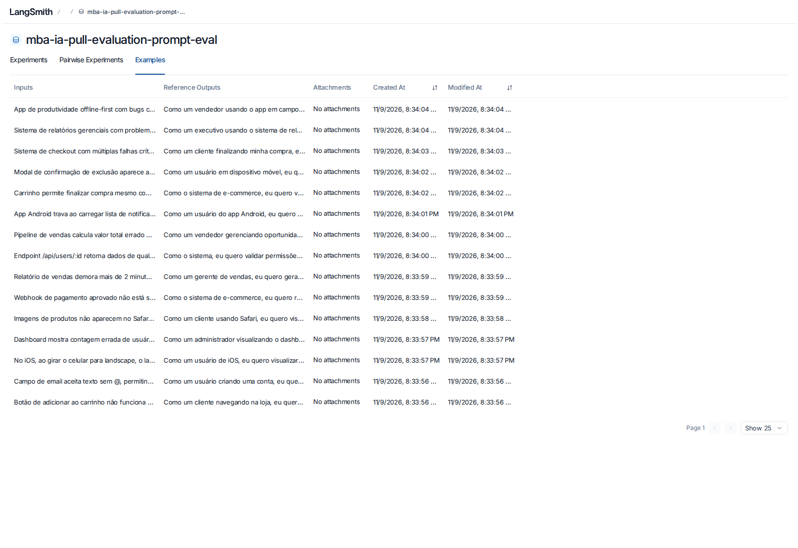

# Pull, Otimização e Avaliação de Prompts com LangChain e LangSmith

Desafio do módulo Prompt Engineering do MBA Full Cycle "Engenharia de Software com IA".
O enunciado completo está em [`ENUNCIADO.md`](ENUNCIADO.md).

O projeto faz pull do prompt `leonanluppi/bug_to_user_story_v1` do LangSmith Prompt Hub,
otimiza esse prompt (`prompts/bug_to_user_story_v2.yml`), publica a versão otimizada no Hub
e a avalia com 5 métricas (Helpfulness, Correctness, F1-Score, Clarity e Precision).
O critério de aprovação é nota ≥ 0.8 em todas.

## Estrutura

```
├── .env.example                  # Template das variáveis de ambiente
├── requirements.txt              # Dependências Python
├── prompts/
│   ├── bug_to_user_story_v1.yml  # Prompt original (baixa qualidade)
│   └── bug_to_user_story_v2.yml  # Prompt otimizado
├── datasets/bug_to_user_story.jsonl  # 15 bugs (5 simples, 7 médios, 3 complexos)
├── src/
│   ├── pull_prompts.py           # Pull do Hub -> prompts/bug_to_user_story_v1.yml
│   ├── push_prompts.py           # Valida e faz push público do v2 com metadados
│   ├── evaluate.py               # Avaliação (pronto, não alterado)
│   ├── metrics.py                # Métricas LLM-as-Judge (pronto, não alterado)
│   └── utils.py                  # Funções auxiliares (pronto, não alterado)
├── scripts/eval_local.py         # Medição local, sem experimento no LangSmith
├── tests/test_prompts.py         # Testes de validação do prompt v2
└── docs/                         # Screenshots e saída do terminal da avaliação
```

## Como Executar

### Pré-requisitos

- Python 3.10+
- Conta no [LangSmith](https://smith.langchain.com) com API key
- API key da [OpenAI](https://platform.openai.com/api-keys) (padrão) ou do
  [Google Gemini](https://aistudio.google.com/app/apikey)
- Handle público no LangSmith Hub (passo 2)

Os testes do passo 5 rodam sem nenhuma chave. Os demais passos chamam o LangSmith e o provider de LLM.

### 1. Ambiente virtual e dependências

```bash
python3 -m venv venv
source venv/bin/activate        # Windows: venv\Scripts\activate
pip install -r requirements.txt
```

### 2. Criar o handle do LangSmith Hub

O handle (o "username" em `handle/nome_do_prompt`) só passa a existir quando você torna
um prompt público pela primeira vez. Faça isso antes do push:

1. Abra o LangSmith e vá em **Prompts**
2. Crie um prompt qualquer (pode ser de teste) ou abra um existente
3. Clique nos três pontinhos no canto superior direito, ao lado de **Playground**
4. Escolha **Make Public**
5. Na tela **Choose your public handle**, defina o handle (é definitivo)

### 3. Configurar o `.env`

```bash
cp .env.example .env
```

| Variável | Valor |
|---|---|
| `LANGSMITH_API_KEY` | API key do LangSmith |
| `LANGSMITH_PROJECT` | Nome do projeto (o dataset será `<projeto>-eval`) |
| `USERNAME_LANGSMITH_HUB` | O handle criado no passo 2 |
| `LLM_PROVIDER` | `openai` (padrão) ou `google` |
| `OPENAI_API_KEY` / `GOOGLE_API_KEY` | Chave do provider escolhido |
| `LLM_MODEL` / `EVAL_MODEL` | Modelos do provider que aceitem `temperature=0` (os resultados abaixo usam `gpt-4o` nos dois) |

### 4. Pull do prompt original (v1)

```bash
python3 src/pull_prompts.py
```

Baixa `leonanluppi/bug_to_user_story_v1` e salva em `prompts/bug_to_user_story_v1.yml`.

### 5. Validar o prompt otimizado (v2)

```bash
pytest tests/test_prompts.py -v
```

Resultado esperado: `9 passed`. São os 6 testes exigidos (`test_prompt_has_system_prompt`,
`test_prompt_has_role_definition`, `test_prompt_mentions_format`,
`test_prompt_has_few_shot_examples`, `test_prompt_no_todos`, `test_minimum_techniques`)
e 3 extras: estrutura do YAML, template montável e `{bug_report}` como única variável,
presente só no user prompt.

### 6. Push do v2 para o Hub (público)

```bash
python3 src/push_prompts.py
```

Valida o YAML e publica `<USERNAME_LANGSMITH_HUB>/bug_to_user_story_v2` com
`is_public=True`, descrição, README e tags (incluindo as técnicas aplicadas).

### 7. Avaliar

```bash
python3 src/evaluate.py
```

Cria ou reutiliza o dataset `<LANGSMITH_PROJECT>-eval` (15 exemplos), puxa o v2 do Hub,
roda o experimento e imprime as 5 métricas e o link do experimento.

Resultado esperado: as 5 métricas com ✓ e `STATUS: APROVADO - Todas as métricas >= 0.8`.
A saída da execução registrada aqui está em [`docs/evaluate_v2_output.txt`](docs/evaluate_v2_output.txt).
O juiz é um LLM, então as notas variam alguns centésimos entre execuções.

### 8. Iterar até ≥ 0.8 em todas as métricas

1. Abra o experimento no LangSmith e veja os exemplos com nota baixa e o `reasoning` do juiz
2. Ajuste `prompts/bug_to_user_story_v2.yml`
3. Repita os passos 5, 6 e 7

Para medir um YAML local sem publicar nem criar experimento (somente com `LLM_PROVIDER=openai`):

```bash
python3 scripts/eval_local.py prompts/bug_to_user_story_v1.yml
```

### 9. Compartilhar o dataset (link público)

```python
from langsmith import Client

print(Client().share_dataset(dataset_name="<seu LANGSMITH_PROJECT>-eval")["url"])
```

Rode uma vez e guarde o endereço: compartilhar de novo gera outro link.

## Técnicas Aplicadas (Fase 2)

O avaliador (`src/metrics.py`) guiou as escolhas:

- F1-Score compara a resposta com a referência do dataset. É preciso cobrir o que a
  referência cobre sem acrescentar informação irrelevante.
- Clarity mede organização, linguagem simples e concisão. Precision mede ausência de
  alucinações e foco no pedido.
- Helpfulness = média(Clarity, Precision) e Correctness = média(F1, Precision).
  Precision entra em 3 das 5 métricas.
- A saída avaliada é o texto bruto do modelo. Raciocínio exposto ou saudação entra na nota.

As referências do dataset têm três formatos, conforme a complexidade do bug:

- Simples: frase "Como um ..., eu quero ..., para que ..." e `Critérios de Aceitação:`
  com 5 linhas Dado/Quando/Então/E.
- Médio: o mesmo, mais seções como `Contexto Técnico:` ou `Critérios Técnicos:`.
- Complexo: blocos `=== USER STORY PRINCIPAL ===`, `=== CRITÉRIOS DE ACEITAÇÃO ===`
  (um grupo por problema), `=== CRITÉRIOS TÉCNICOS ===`, `=== CONTEXTO DO BUG ===`
  e `=== TASKS TÉCNICAS SUGERIDAS ===`.

### 1. Role Prompting

Por quê: uma persona experiente define o vocabulário de backlog, o tom profissional e o
cuidado de não inventar fatos.

Como foi aplicada:

> "Você é um Product Manager Sênior com 10 anos de experiência em times ágeis (Scrum/Kanban),
> especialista em transformar relatos de bugs em User Stories claras, testáveis e prontas
> para o backlog. [...] e é rigoroso em não inventar fatos."

### 2. Few-shot Learning (obrigatória)

Por quê: exemplos fixam o formato e o nível de detalhe. Como as referências mudam de forma
conforme a complexidade, um exemplo por nível mostra quando parar (bug simples) e quando
expandir (bug complexo).

Como foi aplicada: 3 exemplos de entrada/saída próprios (não copiados do dataset), em
domínios diferentes dos avaliados:

1. Simples: link "Esqueci minha senha" que não abre (story + 5 critérios).
2. Médio: exportação de PDF com erro 504 (story + critérios + `Critérios Técnicos` +
   `Contexto Técnico`, preservando os números do relato).
3. Complexo: agendamento de clínica com 3 problemas e seção de impacto (blocos A/B/C,
   contexto e tasks com prefixo `[ÁREA]`).

### 3. Chain of Thought (interno)

Por quê: converter bug em story exige análise (quem é afetado, qual o comportamento correto,
qual a complexidade). Como a saída bruta é avaliada, o raciocínio não pode aparecer.

Como foi aplicada: seção "Processo de raciocínio (faça internamente, passo a passo, sem
exibir)" com 6 passos: persona, objetivo e benefício, fatos do relato, classificação de
complexidade, tipo do bug no checklist de completude e escolha do esqueleto. A seção termina
com a regra "Mostre somente o resultado final; nunca escreva o raciocínio".

### 4. Skeleton of Thought

Por quê: uma estrutura previsível ajuda o juiz a encontrar as informações da referência (F1),
e esqueletos proporcionais evitam inflar bugs simples (Clarity e Precision).

Como foi aplicada: três esqueletos de saída (SIMPLES, MÉDIA, COMPLEXA) com os mesmos títulos
de seção das referências, escolhidos no passo 4 do raciocínio.

### Outros requisitos do prompt

- System vs User Prompt: instruções, regras e exemplos ficam no system. O user prompt tem
  só a tarefa e o `{bug_report}` delimitado por `"""`.
- Regras explícitas (9): começar direto com "Como um", template exato da frase,
  Dado/Quando/Então, preservar literalmente números e endpoints, não inventar fatos,
  linguagem positiva, concisão, Markdown simples, pt-BR.
- Checklist de completude por tipo de bug (ação de UI, validação de formulário,
  compatibilidade, métricas, webhook, performance, controle de acesso, modal, layout,
  estoque, lista mobile) com os critérios esperados em cada um.
  Limitação: o checklist foi derivado das referências do próprio dataset de avaliação e
  não foi testado em bugs fora dele.
- Edge cases: relato vago (story + "Pontos a Esclarecer"), relato vazio ou sem sentido,
  pedido de feature disfarçado de bug, vários problemas no mesmo relato, dados sensíveis
  (não reproduzir) e prompt injection no relato (tratar como dado).
- Metadados no YAML: `techniques_applied`, `techniques_details`, `tags` e `version`,
  enviados ao Hub pelo `push_prompts.py`.

## Resultados Finais

### Evidências no LangSmith

- Link público do dataset de avaliação (com experimentos): https://smith.langchain.com/public/878d617f-58e6-4e14-ad19-d18fae635d70/d
- Prompt público no Hub: https://smith.langchain.com/hub/mbombonato/bug_to_user_story_v2
- Experimento aprovado (tracing das 15 runs): [`mbombonato-bug_to_user_story_v2-f0ee0c98`](https://smith.langchain.com/public/878d617f-58e6-4e14-ad19-d18fae635d70/d/compare?selectedSessions=c15e56c8-13ed-40ab-885a-870385d25e9a)
- Saída completa do terminal: [`docs/evaluate_v2_output.txt`](docs/evaluate_v2_output.txt)

### Notas obtidas

| Métrica | v1 (original) | v2 (otimizado) |
|---|---|---|
| Helpfulness | 0.89 | 0.90 ✓ |
| Correctness | 0.84 | 0.88 ✓ |
| F1-Score | 0.79 ✗ | 0.87 ✓ |
| Clarity | 0.89 | 0.91 ✓ |
| Precision | 0.89 | 0.89 ✓ |
| Média | 0.86 (reprovado: F1 < 0.8) | 0.89 (aprovado) |

Modelos: `LLM_PROVIDER=openai`, `LLM_MODEL=gpt-4o`, `EVAL_MODEL=gpt-4o`, temperature 0.

As notas do v2 vêm do `python3 src/evaluate.py`. As do v1 vêm do
`python3 scripts/eval_local.py prompts/bug_to_user_story_v1.yml`, que usa as mesmas funções
de `src/metrics.py`, os mesmos 15 exemplos e os mesmos modelos, sem criar experimento no
LangSmith.

### Screenshots

Avaliação do v2 aprovada (saída do `python3 src/evaluate.py`):



Experimento aprovado no LangSmith, com as 15 runs (entrada, referência, saída e as 5 notas):



Tracing detalhado de 3 exemplos:





Histórico dos 4 experimentos (o #4 é o aprovado):



Dataset de avaliação com os 15 exemplos:



### Comparação v1 × v2: o que mudou e por quê

| Aspecto | v1 | v2 | Por quê |
|---|---|---|---|
| Persona | "assistente que ajuda" | Product Manager Sênior em times ágeis | Vocabulário e rigor de backlog |
| Separação system/user | `{bug_report}` nos dois | Instruções no system, relato só no user | Separa instrução de dado; evita repetição |
| Formato | Nenhum | Template "Como um / eu quero / para que" + Dado/Quando/Então | Estrutura igual à das referências (F1 e Clarity) |
| Profundidade | Indefinida | 3 esqueletos por complexidade | Cobre bugs complexos sem inflar os simples |
| Exemplos | Nenhum | 3 exemplos (simples, médio, complexo) | Few-shot fixa formato e nível de detalhe |
| Raciocínio | Nenhum | CoT interno, sem expor | Melhor análise sem poluir a saída avaliada |
| Alucinação | Sem regra | Preservar fatos literalmente; não inventar | Precision entra em 3 das 5 métricas |
| Edge cases | Nenhum | Vago, vazio, feature, múltiplos problemas, dados sensíveis, injection | Robustez |

### Histórico de iterações

Cada linha é um experimento no LangSmith (#1 a #4).

| Iteração | Mudança no prompt | Modelo | F1 | Resultado |
|---|---|---|---|---|
| 1 | Versão inicial com as quatro técnicas | gpt-4o-mini | 0.76 | Reprovado: bugs médios tratados como complexos e seções extras em bugs simples |
| 2 | Árvore de decisão para a complexidade; "em bugs SIMPLES a resposta termina aqui"; proibição de `===` e Tasks em bugs médios | gpt-4o-mini | 0.79 | Reprovado |
| 3 | Mesmo prompt da iteração 2 | gpt-4o | 0.78 | Reprovado: trocar o modelo não bastou |
| 4 | Checklist de completude por tipo de bug ligado ao CoT; meta de performance nunca igual ao valor atual do bug; "Pontos a Esclarecer" só em relatos vagos | gpt-4o | 0.87 | Aprovado: todas as métricas ≥ 0.8 |

Com gpt-4o-mini, o prompt com checklist ficou em F1 ≈ 0.79–0.80 na medição local
(`scripts/eval_local.py`). Por isso a combinação final usa gpt-4o.
