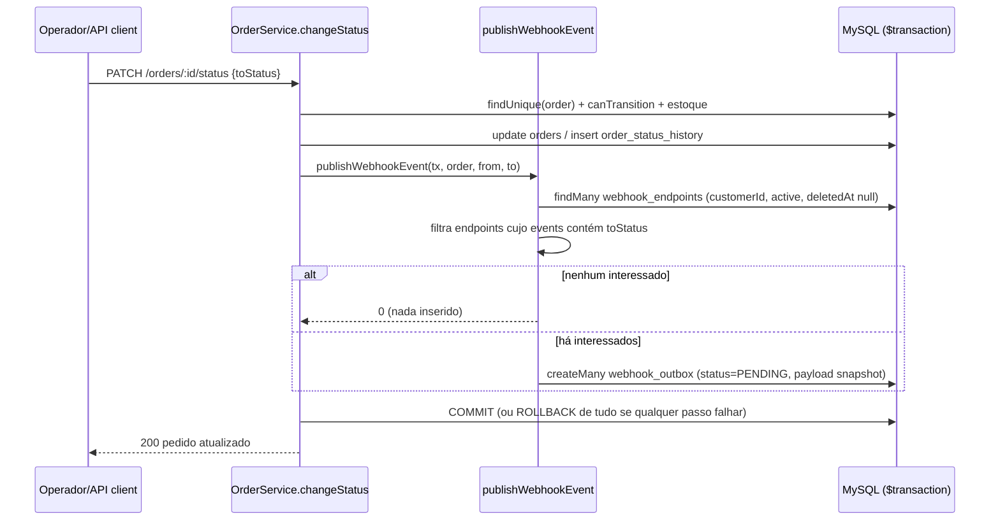

# FDD — Sistema de Webhooks de Notificação de Pedidos

| Campo | Valor |
| --- | --- |
| **Feature** | Webhooks outbound de mudança de status de pedido |
| **Autor** | Matheus Bombonato |
| **Status** | Em revisão (itens marcados com ⚠️ dependem das [questões em aberto do RFC](RFC.md#questões-em-aberto)) |
| **Base** | [RFC-001](RFC.md) · [ADR-001 a ADR-007](adrs/README.md) · [PRD](PRD.md) |
| **Código de referência** | `src/modules/orders/order.service.ts`, `src/shared/errors/`, `src/middlewares/`, `prisma/schema.prisma` |

> Convenção: caminhos marcados como **novo/a criar** (`src/worker.ts`, `src/modules/webhooks/*`) ainda não existem e fazem parte da implementação; todos os demais caminhos citados existem no repositório atual.
>
> Itens com ID (`FDD-…`) estão rastreados em [TRACKER.md](TRACKER.md). Itens marcados como **proposta de implementação** não foram decididos na reunião; são escolhas deste documento para tornar a especificação acionável e devem ser confirmados na sessão de revisão (`[09:50] Larissa`).

---

## 1. Contexto e motivação técnica

O OMS não possui nenhum mecanismo de notificação externa. Toda mudança de status de pedido passa por `OrderService.changeStatus` (`src/modules/orders/order.service.ts`), que abre um `prisma.$transaction` e, em sequência: valida a transição com `canTransition` (`src/modules/orders/order.status.ts`), debita/repõe estoque (`shouldDebitStock`/`shouldReplenishStock`), atualiza `orders.status` e insere em `order_status_history`.

Três clientes B2B fazem polling em `GET /orders` para detectar mudanças (`[09:00] Marcos`). A feature substitui esse polling por um POST HTTPS assinado para um endpoint do cliente, com latência abaixo de 10 s (`[09:02] Marcos`).

Motivações técnicas que moldam o desenho:

- A transação de `changeStatus` não pode conter I/O de rede (`[09:04] Bruno`) → outbox ([ADR-001](adrs/ADR-001-outbox-transacional-no-mysql.md)).
- O evento não pode se perder se o status mudou, nem existir se o status não mudou (`[09:06] Diego`, `[09:40] Bruno`) → inserção na mesma transação.
- O time é pequeno e não quer infraestrutura nova (`[09:07] Diego`) → MySQL + processo Node separado ([ADR-002](adrs/ADR-002-worker-separado-com-polling.md)).

## 2. Objetivos técnicos

| ID | Objetivo | Origem |
| --- | --- | --- |
| FDD-OBJ-01 | Latência entre commit da mudança de status e o primeiro POST ao cliente **< 10 s** (meta de projeto: ≤ 2 s de espera de polling + tempo de envio). | `[09:02] Marcos`, `[09:10] Larissa` |
| FDD-OBJ-02 | **Zero** mudanças de status com webhook interessado sem evento correspondente na outbox (atomicidade). | `[09:40] Bruno` |
| FDD-OBJ-03 | Sobreviver a indisponibilidades do cliente de até ~14h36min sem perder o evento. | `[09:17] Diego` |
| FDD-OBJ-04 | Nenhuma alteração no formato de erro, logger ou autenticação existentes; nenhuma dependência npm nova. | `[09:29] Bruno`, `[09:30] Larissa` |

## 3. Escopo e exclusões

**Incluso**

- Módulo novo `src/modules/webhooks` — a criar (CRUD de configuração, rotação de secret, histórico de entregas, replay de DLQ).
- Tabelas `webhook_endpoints`, `webhook_outbox`, `webhook_deliveries`, `webhook_dead_letter`.
- Função `publishWebhookEvent(tx, order, fromStatus, toStatus)` chamada por `changeStatus`.
- Entry-point novo `src/worker.ts` (a criar) + script `npm run worker`.
- Evento único: `order.status_changed`.

**Excluído (com origem)**

| ID | Exclusão | Origem |
| --- | --- | --- |
| FDD-EXC-01 | Webhooks inbound (clientes enviando para nós). | `[09:02] Marcos` |
| FDD-EXC-02 | E-mail de alerta para cliente com webhook falhando. | `[09:37] Larissa` |
| FDD-EXC-03 | Rate limiting de saída (observar e decidir depois). | `[09:39] Larissa` |
| FDD-EXC-04 | Dashboard/painel visual (projeto separado do time de frontend). | `[09:40] Larissa` |
| FDD-EXC-05 | Arquivamento/limpeza das linhas entregues da outbox. | `[09:08] Diego` |
| FDD-EXC-06 | Múltiplos workers em paralelo / ordenação global. | `[09:13] Diego`, `[09:14] Marcos` |
| FDD-EXC-07 | Itens do pedido no payload. | `[09:43] Diego` |
| FDD-EXC-08 | Eventos de criação de pedido: `create()` grava o status inicial `PENDING` sem passar por `changeStatus`, e nenhuma transição leva a `PENDING`; portanto `PENDING` nunca gera evento. | `src/modules/orders/order.service.ts`, `src/modules/orders/order.status.ts` |
| FDD-EXC-09 | Listagem de DLQ via API (só o replay foi discutido); a consulta é feita direto no banco nesta fase. | `[09:18] Diego` |

## 4. Modelo de dados

Acréscimos em `prisma/schema.prisma` (uma migration nova, puramente aditiva). IDs UUID `Char(36)` como o resto do schema (`[09:51] Larissa`).

```prisma
enum WebhookOutboxStatus {
  PENDING      // pendente
  PROCESSING   // processando
  DELIVERED    // entregue
  FAILED       // falhou (esgotou tentativas → copiado para webhook_dead_letter)
}

model WebhookEndpoint {
  id                      String    @id @default(uuid()) @db.Char(36)
  customerId              String    @db.Char(36)
  url                     String    @db.VarChar(2048)
  secret                  String    @db.VarChar(255)   // ⚠️ formato de armazenamento: RFC-QA-08
  previousSecret          String?   @db.VarChar(255)
  previousSecretExpiresAt DateTime?
  events                  Json                          // OrderStatus[] — ex.: ["SHIPPED","DELIVERED"]
  active                  Boolean   @default(true)
  deletedAt               DateTime?                     // proposta: remoção lógica
  createdAt               DateTime  @default(now())
  updatedAt               DateTime  @updatedAt

  customer   Customer            @relation(fields: [customerId], references: [id])
  outbox     WebhookOutbox[]
  deliveries WebhookDelivery[]

  @@index([customerId, active])
  @@map("webhook_endpoints")
}

model WebhookOutbox {
  id            String              @id @default(uuid()) @db.Char(36)
  eventId       String              @unique @db.Char(36)   // enviado em X-Event-Id
  webhookId     String              @db.Char(36)
  orderId       String              @db.Char(36)           // sem FK: pedido CANCELLED pode ser excluído
  eventType     String              @db.VarChar(64)        // "order.status_changed"
  payload       Json                                       // snapshot renderizado na inserção
  status        WebhookOutboxStatus @default(PENDING)
  attempts      Int                 @default(0)
  nextAttemptAt DateTime            @default(now())
  lastError     String?             @db.VarChar(1000)
  deliveredAt   DateTime?
  createdAt     DateTime            @default(now())
  updatedAt     DateTime            @updatedAt

  webhook    WebhookEndpoint   @relation(fields: [webhookId], references: [id])
  deliveries WebhookDelivery[]

  @@index([status, createdAt])
  @@index([status, nextAttemptAt])
  @@index([orderId])
  @@map("webhook_outbox")
}

model WebhookDelivery {
  id           String   @id @default(uuid()) @db.Char(36)
  outboxId     String   @db.Char(36)
  webhookId    String   @db.Char(36)
  eventId      String   @db.Char(36)
  attempt      Int
  success      Boolean
  statusCode   Int?
  errorCode    String?  @db.VarChar(64)    // WEBHOOK_* do worker
  responseBody String?  @db.Text           // proposta: truncado em 4 KB
  durationMs   Int
  createdAt    DateTime @default(now())

  outbox  WebhookOutbox   @relation(fields: [outboxId], references: [id])
  webhook WebhookEndpoint @relation(fields: [webhookId], references: [id])

  @@index([webhookId, createdAt])
  @@map("webhook_deliveries")
}

model WebhookDeadLetter {
  id            String    @id @default(uuid()) @db.Char(36)
  outboxId      String    @db.Char(36)
  eventId       String    @db.Char(36)
  webhookId     String    @db.Char(36)
  payload       Json
  failureCode   String    @db.VarChar(64)
  failureReason String    @db.VarChar(1000)
  attempts      Int
  failedAt      DateTime  @default(now())
  replayedAt    DateTime?
  replayedById  String?   @db.Char(36)

  @@index([webhookId])
  @@index([failedAt])
  @@map("webhook_dead_letter")
}
```

Notas:

- `Customer` ganha a relação inversa `webhooks WebhookEndpoint[]`.
- `events` é `Json` porque o conector MySQL do Prisma não suporta listas escalares; o conteúdo é validado por Zod na entrada.
- `orderId` na outbox **não** tem FK: `OrderService.delete` permite excluir pedidos `CANCELLED` (`src/modules/orders/order.service.ts`), e um evento `CANCELLED` ainda pendente não pode desaparecer por cascade.
- Uma linha de outbox é criada **por endpoint interessado**, cada uma com seu próprio `eventId`. Isso mantém retry, DLQ e histórico independentes por endpoint (proposta de implementação derivada de `[09:25] Diego` + `[09:34] Bruno`).

## 5. Fluxos detalhados

### 5.1 Fluxo 1 — Criação do evento na outbox

Gatilho: `PATCH /api/v1/orders/:id/status` → `OrderController.changeStatus` → `OrderService.changeStatus`.



| ID | Passo | Origem |
| --- | --- | --- |
| FDD-FLX-01 | Chamada a `publishWebhookEvent` **depois** de `orderStatusHistory.create` e **antes** do `findUnique` de retorno, usando o mesmo `tx`. | `[09:40] Bruno`, `[09:41] Bruno` |
| FDD-FLX-02 | Seleciona endpoints ativos e não removidos do `order.customerId`; filtra pelos que têm `toStatus` em `events`. Sem interessados → nenhuma linha. | `[09:33] Marcos`, `[09:34] Bruno` |
| FDD-FLX-03 | Para cada interessado: gera `eventId` (UUID v4, pacote `uuid` já usado em `src/middlewares/request-logger.middleware.ts`), renderiza o payload snapshot (§6.8) e insere com `status=PENDING`, `attempts=0`, `nextAttemptAt=now()`. | `[09:25] Diego`, `[09:52] Larissa` |
| FDD-FLX-04 | Qualquer erro na inserção é propagado; o `$transaction` faz rollback de status, histórico e estoque. A API responde `500 WEBHOOK_OUTBOX_INSERT_FAILED`. | `[09:40] Bruno`, `[09:41] Diego` |

Esboço da função (arquivo novo `src/modules/webhooks/webhook.publisher.ts`):

```ts
export async function publishWebhookEvent(
  tx: Prisma.TransactionClient,
  order: Order,
  fromStatus: OrderStatus,
  toStatus: OrderStatus,
): Promise<string[]> {
  const endpoints = await tx.webhookEndpoint.findMany({
    where: { customerId: order.customerId, active: true, deletedAt: null },
  });
  const interested = endpoints.filter((e) => (e.events as OrderStatus[]).includes(toStatus));
  if (interested.length === 0) return [];

  const occurredAt = new Date().toISOString();
  const rows = interested.map((endpoint) => {
    const eventId = uuidv4();
    return {
      eventId,
      webhookId: endpoint.id,
      orderId: order.id,
      eventType: 'order.status_changed',
      payload: buildOrderStatusChangedPayload({ eventId, occurredAt, order, fromStatus, toStatus }),
    };
  });
  try {
    await tx.webhookOutbox.createMany({ data: rows });
  } catch (err) {
    throw new WebhookOutboxInsertError(err); // AppError 500, força rollback
  }
  return rows.map((r) => r.eventId);
}
```

### 5.2 Fluxo 2 — Processamento pelo worker

Processo: `npm run worker` → `src/worker.ts` (novo) → `WebhookProcessor` (`src/modules/webhooks/webhook.processor.ts`, novo).

| ID | Passo | Origem |
| --- | --- | --- |
| FDD-FLX-05 | **Boot:** cria `PrismaClient` próprio via `createPrismaClient()` e logger filho `logger.child({ component: 'webhook-worker' })`; registra `SIGINT`/`SIGTERM` como em `src/server.ts`. | `[09:30] Bruno`, `src/server.ts` |
| FDD-FLX-06 | **Recuperação:** no boot, linhas em `PROCESSING` voltam para `PENDING` (seguro porque só existe um worker). | `[09:12] Diego` (single-worker) |
| FDD-FLX-07 | **Polling:** a cada `WEBHOOK_POLL_INTERVAL_MS` (2000) busca `status=PENDING AND nextAttemptAt <= now()` ordenado por `createdAt ASC`, `LIMIT WEBHOOK_BATCH_SIZE` (proposta: 10). | `[09:08] Diego`, `[09:09] Diego` |
| FDD-FLX-08 | **Processamento sequencial** do lote (sem concorrência), preservando a ordem de `createdAt` → ordenação por `order_id` enquanto single-worker. | `[09:12] Diego`, `[09:13] Larissa` |
| FDD-FLX-09 | Para cada evento: marca `PROCESSING`; carrega o endpoint; se inativo/removido → DLQ com `WEBHOOK_ENDPOINT_INACTIVE`; se sem secret → DLQ com `WEBHOOK_SECRET_REQUIRED` (nunca envia sem assinatura). | `[09:21] Bruno`, `[09:19] Sofia` |
| FDD-FLX-10 | Serializa o payload **uma única vez** (`body = JSON.stringify(payload)`); se `Buffer.byteLength(body) > 65536` → DLQ imediata com `WEBHOOK_PAYLOAD_TOO_LARGE`, sem retry (erro determinístico). | `[09:23] Sofia`, `[09:24] Larissa` |
| FDD-FLX-11 | Assina `body` com HMAC-SHA256 (`node:crypto`) e envia `POST` com os headers de §6.8 usando `fetch` nativo + `AbortSignal.timeout(10000)`. | `[09:20] Sofia`, `[09:42] Diego` |
| FDD-FLX-12 | Grava uma linha em `webhook_deliveries` por tentativa (status code, duração, corpo de resposta truncado, `errorCode`). | `[09:34] Marcos` |
| FDD-FLX-13 | **2xx** → `status=DELIVERED`, `deliveredAt=now()`. Qualquer outro resultado (não-2xx, timeout, erro de rede) → Fluxo 3. | `[09:42] Diego` |
| FDD-FLX-14 | Após o lote, dorme até o próximo ciclo; erro de banco no ciclo é logado e o loop continua no ciclo seguinte. | proposta derivada de `[09:11] Diego` |

> Por que checar 64 KB no worker e não na inserção? Lançar erro dentro de `changeStatus` faria rollback da mudança de status por causa de um webhook — exatamente o acoplamento rejeitado em `[09:04] Bruno`. No worker, o evento é recusado sem afetar o pedido.

### 5.3 Fluxo 3 — Retry com backoff

Constante em `webhook.processor.ts`: `RETRY_DELAYS_MS = [60_000, 300_000, 1_800_000, 7_200_000, 43_200_000]` (1m, 5m, 30m, 2h, 12h — `[09:17] Diego`).

| ID | Regra | Origem |
| --- | --- | --- |
| FDD-FLX-15 | Em falha: `attempts += 1`, `lastError = <código + mensagem>`. | `[09:15] Diego` |
| FDD-FLX-16 | Se `attempts <= 5` → `status=PENDING`, `nextAttemptAt = now() + RETRY_DELAYS_MS[attempts - 1]`. | `[09:17] Larissa` |
| FDD-FLX-17 | Se `attempts > 5` (envio inicial + 5 retentativas falharam) → Fluxo 4. ⚠️ Interpretação a confirmar (RFC-QA-07). | `[09:17] Diego` |
| FDD-FLX-18 | O `eventId` e o `payload` **nunca mudam** entre tentativas; só `X-Timestamp` e a assinatura são recalculados por envio. | `[09:25] Diego`, `[09:52] Bruno` |

Linha do tempo de um evento para cliente fora do ar: T0 (envio) → T0+1m → +5m → +30m → +2h → +12h → DLQ (~14h36min após a primeira falha).

### 5.4 Fluxo 4 — DLQ e replay manual

| ID | Passo | Origem |
| --- | --- | --- |
| FDD-FLX-19 | Na mesma transação: outbox `status=FAILED` + `INSERT` em `webhook_dead_letter` com `payload`, `failureCode`, `failureReason`, `attempts`, `failedAt`. | `[09:18] Diego` |
| FDD-FLX-20 | Replay: `POST /api/v1/admin/webhooks/dead-letter/:id/replay` (role `ADMIN`). Em transação: valida que a DLQ existe e não foi reprocessada; outbox volta para `PENDING`, `attempts=0`, `nextAttemptAt=now()`, `lastError=null`; DLQ recebe `replayedAt` e `replayedById`. | `[09:18] Diego`, `[09:36] Larissa` |
| FDD-FLX-21 | O replay mantém o mesmo `eventId` — o cliente deduplica se já tiver processado. | `[09:25] Diego` |
| FDD-FLX-22 | Log de auditoria `webhook_dead_letter_replayed` com `userId`, `deadLetterId`, `eventId`. | `[09:36] Sofia` |
| FDD-FLX-23 | Se o evento falhar de novo, uma **nova** linha de DLQ é criada (a anterior permanece como histórico). | proposta de implementação |

### 5.5 Fluxo 5 — Rotação de secret

| ID | Passo | Origem |
| --- | --- | --- |
| FDD-FLX-24 | `POST /api/v1/webhooks/:id/rotate-secret`: `previousSecret = secret`, `previousSecretExpiresAt = now() + 24h`, `secret = nova secret` (32 bytes de `crypto.randomBytes`, hex — proposta, ⚠️ revisão Sofia). | `[09:21] Sofia`, `[09:46] Sofia` |
| FDD-FLX-25 | Enquanto `previousSecretExpiresAt > now()`, o worker assina com **as duas** secrets e envia ambas em `X-Signature` (§6.8). Depois disso só a nova. ⚠️ Mecanismo a validar (RFC-QA-08). | `[09:21] Sofia` |
| FDD-FLX-26 | Nova rotação durante o grace period é recusada com `409 WEBHOOK_SECRET_ROTATION_IN_PROGRESS`, para não invalidar abruptamente uma secret ainda em uso (proposta). | `[09:21] Sofia` |

## 6. Contratos públicos

### 6.1 Convenções

- Prefixo `/api/v1` (montado em `src/app.ts` → `buildApiRouter`).
- Autenticação: `Authorization: Bearer <JWT>` via `authenticate`; CRUD aceita qualquer role (`ADMIN` ou `OPERATOR`) (`[09:37] Sofia`); replay exige `ADMIN` (`[09:36] Sofia`).
- `customerId` **não** vem do JWT — o JWT é de usuário operador (`[09:32] Bruno`, `[09:32] Larissa`).
- Respostas da API REST em camelCase (como os demais módulos); o payload enviado ao cliente segue os nomes snake_case definidos na reunião (`[09:43] Diego`).
- Erros no formato do `errorMiddleware`: `{ "error": { "code", "message", "details?" } }`.
- O campo `events` aceita um subconjunto não vazio de `PAID`, `PROCESSING`, `SHIPPED`, `DELIVERED`, `CANCELLED` (os destinos possíveis em `src/modules/orders/order.status.ts`).

### 6.2 FDD-CONTRATO-01 — `POST /api/v1/webhooks` (cadastrar)

Origem: `[09:31] Marcos`, `[09:23] Sofia`.

Request:

```http
POST /api/v1/webhooks
Authorization: Bearer eyJhbGciOi...
Content-Type: application/json

{
  "customerId": "3f0e4c3a-9a51-4b8e-9d0e-2a7c1d5b6f10",
  "url": "https://hooks.atlascomercial.com.br/oms/orders",
  "events": ["SHIPPED", "DELIVERED"]
}
```

Response `201 Created` — **única** resposta que devolve a secret:

```json
{
  "id": "b8a6f2de-5c1e-4f7a-8f0b-6c2d9e4a1b33",
  "customerId": "3f0e4c3a-9a51-4b8e-9d0e-2a7c1d5b6f10",
  "url": "https://hooks.atlascomercial.com.br/oms/orders",
  "events": ["SHIPPED", "DELIVERED"],
  "active": true,
  "secret": "9f1c0b7e4d2a...e6",
  "createdAt": "2026-11-12T13:58:02.114Z",
  "updatedAt": "2026-11-12T13:58:02.114Z"
}
```

| Status | Quando |
| --- | --- |
| 201 | Criado. |
| 400 `WEBHOOK_INVALID_URL` | URL inválida ou não `https`. |
| 400 `VALIDATION_ERROR` | Body fora do schema (ex.: `events` vazio ou com `PENDING`). |
| 401 `UNAUTHORIZED` | Sem token / token inválido. |
| 404 `WEBHOOK_CUSTOMER_NOT_FOUND` | `customerId` inexistente. |

### 6.3 FDD-CONTRATO-02 — `GET /api/v1/customers/:customerId/webhooks` (listar)

Origem: `[09:33] Bruno`, `[09:32] Larissa`. Retorna endpoints não removidos do customer; **nunca** retorna `secret`.

Request:

```http
GET /api/v1/customers/3f0e4c3a-9a51-4b8e-9d0e-2a7c1d5b6f10/webhooks
Authorization: Bearer eyJhbGciOi...
```

Response `200 OK`:

```json
{
  "data": [
    {
      "id": "b8a6f2de-5c1e-4f7a-8f0b-6c2d9e4a1b33",
      "customerId": "3f0e4c3a-9a51-4b8e-9d0e-2a7c1d5b6f10",
      "url": "https://hooks.atlascomercial.com.br/oms/orders",
      "events": ["SHIPPED", "DELIVERED"],
      "active": true,
      "secretRotationExpiresAt": null,
      "createdAt": "2026-11-12T13:58:02.114Z",
      "updatedAt": "2026-11-12T13:58:02.114Z"
    }
  ]
}
```

| Status | Quando |
| --- | --- |
| 200 | Lista (pode ser vazia). |
| 400 `VALIDATION_ERROR` | `customerId` não é UUID. |
| 401 `UNAUTHORIZED` | Sem token. |
| 404 `WEBHOOK_CUSTOMER_NOT_FOUND` | Customer inexistente. |

### 6.4 FDD-CONTRATO-03 — `PATCH /api/v1/webhooks/:id` (editar)

Origem: `[09:33] Bruno`. Campos opcionais, ao menos um: `url`, `events`, `active`. Alterações valem apenas para eventos **futuros** (snapshot/filtro na inserção — [ADR-007](adrs/ADR-007-snapshot-do-payload-e-filtro-na-insercao.md)).

Request:

```http
PATCH /api/v1/webhooks/b8a6f2de-5c1e-4f7a-8f0b-6c2d9e4a1b33
Authorization: Bearer eyJhbGciOi...
Content-Type: application/json

{ "events": ["PAID", "SHIPPED", "DELIVERED", "CANCELLED"], "active": true }
```

Response `200 OK`:

```json
{
  "id": "b8a6f2de-5c1e-4f7a-8f0b-6c2d9e4a1b33",
  "customerId": "3f0e4c3a-9a51-4b8e-9d0e-2a7c1d5b6f10",
  "url": "https://hooks.atlascomercial.com.br/oms/orders",
  "events": ["PAID", "SHIPPED", "DELIVERED", "CANCELLED"],
  "active": true,
  "secretRotationExpiresAt": null,
  "createdAt": "2026-11-12T13:58:02.114Z",
  "updatedAt": "2026-11-12T14:10:45.902Z"
}
```

| Status | Quando |
| --- | --- |
| 200 | Atualizado. |
| 400 `WEBHOOK_INVALID_URL` / `VALIDATION_ERROR` | URL não `https` / body inválido ou vazio. |
| 401 `UNAUTHORIZED` | Sem token. |
| 404 `WEBHOOK_NOT_FOUND` | Inexistente ou removido. |

### 6.5 FDD-CONTRATO-04 — `POST /api/v1/webhooks/:id/rotate-secret` (rotacionar secret)

Origem: `[09:21] Sofia`.

Request:

```http
POST /api/v1/webhooks/b8a6f2de-5c1e-4f7a-8f0b-6c2d9e4a1b33/rotate-secret
Authorization: Bearer eyJhbGciOi...
```

Response `200 OK`:

```json
{
  "id": "b8a6f2de-5c1e-4f7a-8f0b-6c2d9e4a1b33",
  "secret": "4be08d1c77a0...a9",
  "previousSecretExpiresAt": "2026-11-13T14:20:00.000Z"
}
```

| Status | Quando |
| --- | --- |
| 200 | Nova secret gerada; antiga válida por 24 h. |
| 401 `UNAUTHORIZED` | Sem token. |
| 404 `WEBHOOK_NOT_FOUND` | Inexistente ou removido. |
| 409 `WEBHOOK_SECRET_ROTATION_IN_PROGRESS` | Já existe secret anterior dentro do grace period. |

### 6.6 FDD-CONTRATO-05 — `DELETE /api/v1/webhooks/:id` (remover)

Origem: `[09:33] Bruno`. Remoção lógica (`active=false`, `deletedAt=now()`) para preservar histórico de entregas e DLQ como evidência (`[09:18] Diego`) — proposta de implementação. Eventos ainda pendentes desse endpoint vão para a DLQ com `WEBHOOK_ENDPOINT_INACTIVE` quando o worker os encontrar.

Request:

```http
DELETE /api/v1/webhooks/b8a6f2de-5c1e-4f7a-8f0b-6c2d9e4a1b33
Authorization: Bearer eyJhbGciOi...
```

Response `204 No Content` (sem corpo).

| Status | Quando |
| --- | --- |
| 204 | Removido. |
| 401 `UNAUTHORIZED` | Sem token. |
| 404 `WEBHOOK_NOT_FOUND` | Inexistente ou já removido. |

### 6.7 FDD-CONTRATO-06 — `GET /api/v1/webhooks/:id/deliveries` (histórico de entregas)

Origem: `[09:34] Marcos`. Retorna as **100 tentativas mais recentes**, da mais nova para a mais antiga, com sucesso/falha, payload, resposta e tempo de resposta.

Request:

```http
GET /api/v1/webhooks/b8a6f2de-5c1e-4f7a-8f0b-6c2d9e4a1b33/deliveries
Authorization: Bearer eyJhbGciOi...
```

Response `200 OK`:

```json
{
  "data": [
    {
      "id": "0d9b7e52-1f3c-4c8a-b0e1-5a4f2c6d7e88",
      "eventId": "7c9e6679-7425-40de-944b-e07fc1f90ae7",
      "attempt": 2,
      "success": true,
      "statusCode": 200,
      "durationMs": 184,
      "errorCode": null,
      "responseBody": "{\"received\":true}",
      "payload": {
        "event_id": "7c9e6679-7425-40de-944b-e07fc1f90ae7",
        "event_type": "order.status_changed",
        "timestamp": "2026-11-12T14:03:21.418Z",
        "order_id": "e2b1c7a4-6d3f-4a9e-8b2c-1f0e9d8c7b6a",
        "order_number": "ORD-000123",
        "from_status": "PROCESSING",
        "to_status": "SHIPPED",
        "customer_id": "3f0e4c3a-9a51-4b8e-9d0e-2a7c1d5b6f10",
        "subtotal_cents": 20000,
        "discount_cents": 2000,
        "total_cents": 18000
      },
      "createdAt": "2026-11-12T14:04:23.007Z"
    },
    {
      "id": "a17c3e90-2b4d-4e6f-9a8b-7c6d5e4f3a21",
      "eventId": "7c9e6679-7425-40de-944b-e07fc1f90ae7",
      "attempt": 1,
      "success": false,
      "statusCode": null,
      "durationMs": 10000,
      "errorCode": "WEBHOOK_DELIVERY_TIMEOUT",
      "responseBody": null,
      "payload": { "event_id": "7c9e6679-7425-40de-944b-e07fc1f90ae7", "...": "..." },
      "createdAt": "2026-11-12T14:03:23.002Z"
    }
  ]
}
```

| Status | Quando |
| --- | --- |
| 200 | Histórico (pode ser vazio). |
| 401 `UNAUTHORIZED` | Sem token. |
| 404 `WEBHOOK_NOT_FOUND` | Inexistente. |

### 6.8 Contrato de saída: requisição enviada ao cliente

**FDD-CONTRATO-07.** Origem: `[09:43] Diego`, `[09:44] Diego`, `[09:44] Sofia`, `[09:20] Sofia`.

```http
POST https://hooks.atlascomercial.com.br/oms/orders
Content-Type: application/json
X-Event-Id: 7c9e6679-7425-40de-944b-e07fc1f90ae7
X-Webhook-Id: b8a6f2de-5c1e-4f7a-8f0b-6c2d9e4a1b33
X-Timestamp: 2026-11-12T14:03:23.001Z
X-Signature: sha256=5d41402abc4b2a76b9719d911017c592ae0c8f3e1b6d4e2c9a7f0b1c3d5e7f90

{
  "event_id": "7c9e6679-7425-40de-944b-e07fc1f90ae7",
  "event_type": "order.status_changed",
  "timestamp": "2026-11-12T14:03:21.418Z",
  "order_id": "e2b1c7a4-6d3f-4a9e-8b2c-1f0e9d8c7b6a",
  "order_number": "ORD-000123",
  "from_status": "PROCESSING",
  "to_status": "SHIPPED",
  "customer_id": "3f0e4c3a-9a51-4b8e-9d0e-2a7c1d5b6f10",
  "subtotal_cents": 20000,
  "discount_cents": 2000,
  "total_cents": 18000
}
```

| Header | Semântica | Origem |
| --- | --- | --- |
| `Content-Type` | Sempre `application/json`. | `[09:44] Diego` |
| `X-Event-Id` | UUID do evento, gerado na inserção na outbox; estável em retries e replays; chave de deduplicação. | `[09:25] Diego` |
| `X-Webhook-Id` | ID do endpoint cadastrado, para clientes com vários cadastros. | `[09:44] Sofia` |
| `X-Timestamp` | Momento do **envio** (muda a cada tentativa); permite ao cliente detectar replay attack. ⚠️ Não está coberto pela assinatura, que é só sobre o corpo — ponto para a revisão de segurança. | `[09:44] Diego`, `[09:22] Sofia` |
| `X-Signature` | `sha256=<hex(HMAC-SHA256(secret, rawBody))>`. Durante o grace period: `sha256=<nova>,sha256=<antiga>` (⚠️ RFC-QA-08). | `[09:20] Sofia`, `[09:21] Sofia` |

Campos do payload: `timestamp` = momento da mudança de status (snapshot, ISO 8601); `subtotal_cents`/`discount_cents`/`total_cents` vêm de `Order` em `prisma/schema.prisma`; **sem itens** (`[09:43] Diego`).

Resposta esperada do cliente: qualquer **2xx em até 10 s** = entregue. Qualquer outra coisa = falha com retry.

Verificação sugerida para o portal (`[09:26] Marcos`): o cliente recalcula `HMAC-SHA256(secret, rawBody)` sobre o corpo bruto recebido, compara em tempo constante com `X-Signature` e deduplica por `X-Event-Id`.

### 6.9 FDD-CONTRATO-08 — `POST /api/v1/admin/webhooks/dead-letter/:id/replay` (replay de DLQ)

Origem: `[09:18] Diego`, `[09:35] Diego`, `[09:36] Sofia`. Rota com `authenticate` + `requireRole('ADMIN')`.

Request:

```http
POST /api/v1/admin/webhooks/dead-letter/5e7a9c1b-3d2f-4b6e-8a0c-9f1e2d3c4b5a/replay
Authorization: Bearer <JWT de usuário ADMIN>
```

Response `202 Accepted` (o envio acontece no próximo ciclo do worker):

```json
{
  "deadLetterId": "5e7a9c1b-3d2f-4b6e-8a0c-9f1e2d3c4b5a",
  "outboxId": "c3d4e5f6-a7b8-4c9d-8e0f-1a2b3c4d5e6f",
  "eventId": "7c9e6679-7425-40de-944b-e07fc1f90ae7",
  "status": "PENDING",
  "replayedAt": "2026-11-13T09:12:44.551Z",
  "replayedById": "a1b2c3d4-e5f6-4a7b-8c9d-0e1f2a3b4c5d"
}
```

| Status | Quando |
| --- | --- |
| 202 | Evento recolocado na outbox como pendente. |
| 401 `UNAUTHORIZED` | Sem token. |
| 403 `FORBIDDEN` | Usuário autenticado sem role `ADMIN` (erro existente de `requireRole`). |
| 404 `WEBHOOK_DEAD_LETTER_NOT_FOUND` | ID inexistente. |
| 409 `WEBHOOK_DEAD_LETTER_ALREADY_REPLAYED` | Essa linha de DLQ já foi reprocessada. |

## 7. Matriz de erros

Todas as classes novas ficam em `src/modules/webhooks/webhook.errors.ts` (novo), estendem as classes de `src/shared/errors/http-errors.ts` (que por sua vez estendem `AppError`) e são exportadas pelo módulo. Prefixo `WEBHOOK_` em tudo do módulo (`[09:29] Larissa`).

### 7.1 Erros da API (respondidos pelo `errorMiddleware`)

| ID | Código | HTTP | Classe (base) | Onde ocorre | Ação do chamador |
| --- | --- | --- | --- | --- | --- |
| FDD-ERR-01 | `WEBHOOK_NOT_FOUND` | 404 | `WebhookNotFoundError` (`AppError`) | PATCH, DELETE, rotate, deliveries | Verificar o ID. |
| FDD-ERR-02 | `WEBHOOK_INVALID_URL` | 400 | `WebhookInvalidUrlError` (`BadRequestError`) | POST, PATCH com URL inválida ou `http://` | Cadastrar URL `https`. |
| FDD-ERR-03 | `WEBHOOK_CUSTOMER_NOT_FOUND` | 404 | `WebhookCustomerNotFoundError` (`AppError`) | POST, GET listagem | Verificar `customerId`. |
| FDD-ERR-04 | `WEBHOOK_SECRET_ROTATION_IN_PROGRESS` | 409 | `ConflictError` | rotate-secret dentro do grace period (proposta de implementação) | Aguardar expiração da secret anterior. |
| FDD-ERR-05 | `WEBHOOK_DEAD_LETTER_NOT_FOUND` | 404 | `AppError` | replay | Verificar o ID. |
| FDD-ERR-06 | `WEBHOOK_DEAD_LETTER_ALREADY_REPLAYED` | 409 | `ConflictError` | replay repetido (proposta de implementação) | Nenhuma; evento já está na outbox. |
| FDD-ERR-07 | `WEBHOOK_OUTBOX_INSERT_FAILED` | 500 | `AppError` | `PATCH /orders/:id/status` | Mudança de status **não** foi aplicada (rollback); repetir. |
| — | `VALIDATION_ERROR` / `UNAUTHORIZED` / `FORBIDDEN` | 400/401/403 | existentes | todos | Reuso sem alteração. |

> `WEBHOOK_INVALID_URL`: a regra `https` fica declarada em `webhook.schemas.ts` como em todo o projeto (`[09:23] Sofia`), mas é aplicada pelo service via `assertHttpsUrl()` para que o código específico pedido em `[09:28] Bruno` chegue ao cliente — o `validate` middleware converteria qualquer falha de Zod em `VALIDATION_ERROR`.

### 7.2 Erros do worker (registrados em `webhook_deliveries.errorCode`, `webhook_dead_letter.failureCode` e logs)

| ID | Código | Condição | Retry? |
| --- | --- | --- | --- |
| FDD-ERR-08 | `WEBHOOK_DELIVERY_TIMEOUT` | Sem resposta em 10 s. | Sim |
| FDD-ERR-09 | `WEBHOOK_DELIVERY_FAILED` | Resposta não-2xx (código em `statusCode`). | Sim |
| FDD-ERR-10 | `WEBHOOK_DELIVERY_NETWORK_ERROR` | DNS, TLS ou conexão recusada. | Sim |
| FDD-ERR-11 | `WEBHOOK_PAYLOAD_TOO_LARGE` | Corpo > 64 KB. | Não → DLQ |
| FDD-ERR-12 | `WEBHOOK_SECRET_REQUIRED` | Endpoint sem secret válida. | Não → DLQ |
| FDD-ERR-13 | `WEBHOOK_ENDPOINT_INACTIVE` | Endpoint desativado/removido com evento pendente (proposta de implementação). | Não → DLQ |
| FDD-ERR-14 | `WEBHOOK_MAX_ATTEMPTS_EXCEEDED` | Envio inicial + 5 retentativas falharam. | Não → DLQ |

## 8. Observabilidade

Sem bibliotecas novas ([ADR-006](adrs/ADR-006-reuso-dos-padroes-existentes-do-projeto.md)): tudo sai do logger Pino (`src/shared/logger/index.ts`) e das próprias tabelas.

### 8.1 Logs (Pino, JSON estruturado, nomes em snake_case como `server_started`/`http_request`)

| ID | Evento de log | Processo | Campos |
| --- | --- | --- | --- |
| FDD-OBS-01 | `webhook_worker_started` / `webhook_worker_stopped` | worker | `pollIntervalMs`, `batchSize`, `signal` |
| FDD-OBS-02 | `webhook_delivery_attempt` | worker | `eventId`, `webhookId`, `orderId`, `attempt`, `statusCode`, `durationMs`, `success`, `errorCode` |
| FDD-OBS-03 | `webhook_retry_scheduled` | worker | `eventId`, `attempt`, `nextAttemptAt` |
| FDD-OBS-04 | `webhook_dead_lettered` (nível `warn`) | worker | `eventId`, `webhookId`, `failureCode`, `attempts` |
| FDD-OBS-05 | `webhook_dead_letter_replayed` (auditoria) | API | `userId`, `deadLetterId`, `eventId` (`[09:36] Sofia`) |
| FDD-OBS-06 | `webhook_secret_rotated` | API | `webhookId`, `userId`, `previousSecretExpiresAt` — **nunca** a secret |

Redação: ampliar `redactPaths` em `src/shared/logger/index.ts` com `'*.secret'`, `'*.previousSecret'` e `'*.signature'` (incidente de secret vazada em log, `[09:22] Diego`).

### 8.2 Métricas (derivadas de consultas e logs)

| ID | Métrica | Como medir | Alvo / alerta |
| --- | --- | --- | --- |
| FDD-OBS-07 | Idade do evento `PENDING` mais antigo elegível | `now() - MIN(createdAt) WHERE status=PENDING AND attempts=0` | Alerta se > 10 s (`[09:02] Marcos`) |
| FDD-OBS-08 | Latência ponta a ponta (1ª tentativa) | `firstAttempt.createdAt - outbox.createdAt` | p95 < 10 s |
| FDD-OBS-09 | Taxa de sucesso por webhook | `webhook_deliveries.success` agrupado por `webhookId` | Acompanhar tendência |
| FDD-OBS-10 | Tamanho da DLQ | `COUNT(*) webhook_dead_letter WHERE replayedAt IS NULL` | Alerta se > 0 novas no dia |
| FDD-OBS-11 | Envios por webhook por minuto | `webhook_deliveries` agrupado por minuto | Insumo para a decisão de rate limiting (RFC-QA-01) |
| FDD-OBS-12 | Volume da outbox por status | `COUNT(*) GROUP BY status` | Insumo para o arquivamento futuro (RFC-QA-05) |

### 8.3 Tracing (correlação)

| ID | Item |
| --- | --- |
| FDD-OBS-13 | Não há biblioteca de tracing no projeto; a correlação é feita por IDs: `orderId` (API, outbox e worker) → `eventId` (outbox, deliveries, DLQ, header `X-Event-Id`) → `webhookId`. Uma busca por `eventId` nos logs reconstrói a vida inteira de um evento, e o cliente consegue informar o `X-Event-Id` ao suporte. |
| FDD-OBS-14 | No lado da API, o `requestId` já gerado por `src/middlewares/request-logger.middleware.ts` identifica a requisição `PATCH /orders/:id/status` que originou o evento (via `orderId` + horário). Adoção de OpenTelemetry fica fora desta fase. |

## 9. Estratégias de resiliência

| ID | Estratégia | Detalhe | Origem |
| --- | --- | --- | --- |
| FDD-RES-01 | Timeout | 10 s por requisição (`AbortSignal.timeout`). | `[09:42] Diego` |
| FDD-RES-02 | Retry | Envio inicial + 5 retentativas. | `[09:16] Larissa` |
| FDD-RES-03 | Backoff | Exponencial fixo: 1m, 5m, 30m, 2h, 12h (via `nextAttemptAt`, sem bloquear o loop). | `[09:17] Diego` |
| FDD-RES-04 | Fallback | DLQ persistida + replay manual por ADMIN. Sem fallback por e-mail nesta fase. | `[09:18] Diego`, `[09:37] Larissa` |
| FDD-RES-05 | Isolamento de falha | Worker em processo próprio; falha do cliente nunca afeta `changeStatus`. | `[09:11] Diego`, `[09:04] Bruno` |
| FDD-RES-06 | Crash do worker | Linhas `PROCESSING` voltam a `PENDING` no boot; possível reenvio é coberto por at-least-once. | `[09:24] Diego` |
| FDD-RES-07 | Graceful shutdown | Em `SIGTERM`, termina o evento corrente, não pega novo lote e chama `prisma.$disconnect()` (padrão de `src/server.ts`). | `src/server.ts` |
| FDD-RES-08 | Erros determinísticos | Payload > 64 KB, endpoint inativo, sem secret → DLQ direto, sem gastar retries. | `[09:23] Sofia` |
| FDD-RES-09 | Banco indisponível | Ciclo falha, é logado em `error` e o loop tenta de novo no próximo intervalo. | proposta de implementação |

## 10. Integração com o sistema existente

| ID | Arquivo real | Situação hoje | Integração |
| --- | --- | --- | --- |
| FDD-INT-01 | `src/modules/orders/order.service.ts` | `changeStatus` executa `$transaction` com `order.update` e `orderStatusHistory.create`. | Importar `publishWebhookEvent` e chamá-lo com o `tx` logo após `orderStatusHistory.create`, passando `order`, `from` e `to` já calculados no método. Nenhuma mudança de assinatura do construtor nem em `src/app.ts` (`[09:41] Bruno`). |
| FDD-INT-02 | `src/modules/orders/order.status.ts` | Define `transitions`; nenhuma transição leva a `PENDING`. | `webhook.schemas.ts` deriva o enum aceito em `events` dos destinos possíveis (todos os `OrderStatus` exceto `PENDING`). |
| FDD-INT-03 | `src/shared/errors/app-error.ts` e `src/shared/errors/http-errors.ts` | `AppError(message, statusCode, errorCode, details)` + subclasses como `ConflictError`, `BadRequestError`, `InvalidStatusTransitionError`. | Novas classes `Webhook*Error` estendem essas bases com códigos `WEBHOOK_*`, no mesmo estilo de `InvalidStatusTransitionError` (`[09:28] Bruno`). |
| FDD-INT-04 | `src/middlewares/error.middleware.ts` | Serializa `AppError`, `ZodError` e erros conhecidos do Prisma. | **Sem alteração**: os novos erros são `AppError` e saem no formato padrão (`[09:29] Bruno`). |
| FDD-INT-05 | `src/middlewares/auth.middleware.ts` | `authenticate` e `requireRole(...roles)`. | `webhook.routes.ts` usa `router.use(authenticate)`; a rota de replay adiciona `requireRole('ADMIN')`, como `src/modules/users/user.routes.ts` (`[09:36] Larissa`). |
| FDD-INT-06 | `src/middlewares/validate.middleware.ts` | `validate({ body, query, params })` com Zod. | Rotas do módulo usam `validate` com os schemas de `webhook.schemas.ts` (params UUID como `orderIdParamSchema`). |
| FDD-INT-07 | `src/shared/logger/index.ts` | Pino com `redactPaths`. | API e worker usam o mesmo `logger` (worker via `logger.child`); adicionar `*.secret`, `*.previousSecret`, `*.signature` a `redactPaths`. |
| FDD-INT-08 | `src/config/database.ts` | `createPrismaClient()` + singleton `prisma`. | `src/worker.ts` (novo) chama `createPrismaClient()` para ter instância própria com a mesma `DATABASE_URL` (`[09:30] Bruno`). |
| FDD-INT-09 | `src/config/env.ts` | Schema Zod das variáveis de ambiente. | Adicionar `WEBHOOK_POLL_INTERVAL_MS` (default 2000), `WEBHOOK_HTTP_TIMEOUT_MS` (default 10000) e `WEBHOOK_BATCH_SIZE` (default 10, proposta). |
| FDD-INT-10 | `src/server.ts` | Entry-point da API com bootstrap e shutdown por sinal. | Modelo para `src/worker.ts` (novo), mesma estrutura `bootstrap()` + `shutdown(signal)` (`[09:11] Larissa`). |
| FDD-INT-11 | `src/routes/index.ts` e `src/app.ts` | `buildApiRouter(controllers)` monta os routers; `buildControllers` compõe dependências. | Adicionar `webhooks: WebhookController` em `Controllers`, montar `buildWebhookRouter` (rotas `/webhooks`, `/customers/:customerId/webhooks`) e `buildAdminWebhookRouter` (`/admin/webhooks`); instanciar repository/service/controller em `buildControllers`. |
| FDD-INT-12 | `prisma/schema.prisma` | Modelos `Order`, `Customer`, enum `OrderStatus`, IDs UUID. | Novos modelos da §4 + relação inversa em `Customer`; nova pasta em `prisma/migrations/`. |
| FDD-INT-13 | `package.json` | Scripts `dev`, `start`, etc. | Novos scripts `worker` (`node --env-file=.env dist/worker.js`) e `worker:dev` (`tsx watch --env-file=.env src/worker.ts`), seguindo `start`/`dev`. |
| FDD-INT-14 | `tests/setup.ts` e `tests/helpers/factories.ts` | `beforeEach` limpa tabelas em ordem de dependência; factories criam usuário, customer e produto. | Limpar `webhookDelivery`, `webhookDeadLetter`, `webhookOutbox`, `webhookEndpoint` **antes** de `customer`; nova factory `createTestWebhook()`. |

Estrutura nova do módulo — **todos os arquivos abaixo são novos, a criar** (`[09:27] Bruno`, `[09:28] Bruno`):

```
src/modules/webhooks/
├── webhook.controller.ts
├── webhook.service.ts
├── webhook.repository.ts
├── webhook.routes.ts        # buildWebhookRouter + buildAdminWebhookRouter
├── webhook.schemas.ts
├── webhook.errors.ts
├── webhook.publisher.ts     # publishWebhookEvent (usado por orders)
├── webhook.signer.ts        # HMAC-SHA256
└── webhook.processor.ts     # lógica do worker
src/worker.ts                # entry-point do processo worker
```

## 11. Dependências e compatibilidade

| ID | Item | Detalhe |
| --- | --- | --- |
| FDD-DEP-01 | Node.js ≥ 20 (`package.json` → `engines`) | Necessário para `fetch` nativo, `AbortSignal.timeout` e `node:crypto` — sem dependência HTTP nova. |
| FDD-DEP-02 | Prisma 5.22 / MySQL 8 (`docker-compose.yml`) | Mesma base; migration aditiva, sem alterar tabelas existentes além da relação em `Customer`. |
| FDD-DEP-03 | `uuid`, `zod`, `pino` já instalados | Reuso para `eventId`, schemas e logs. |
| FDD-DEP-04 | Compatibilidade da API | Nenhum contrato existente muda; `PATCH /orders/:id/status` só ganha um novo erro possível (`500 WEBHOOK_OUTBOX_INSERT_FAILED`). |
| FDD-DEP-05 | Lado do cliente | Endpoint HTTPS que responda 2xx em até 10 s, valide HMAC-SHA256 e deduplique por `X-Event-Id` (portal do desenvolvedor, `[09:26] Marcos`). |
| FDD-DEP-06 | Operação | Um processo adicional (`npm run worker`), **uma única instância** (`[09:12] Diego`). |

## 12. Critérios de aceite técnicos

| ID | Critério |
| --- | --- |
| FDD-CA-01 | Teste de integração: mudar status de pedido cujo customer tem webhook interessado cria exatamente uma linha `PENDING` em `webhook_outbox` por endpoint interessado, com payload igual ao contrato §6.8. |
| FDD-CA-02 | Teste: se a inserção na outbox falhar, `orders.status`, `order_status_history` e estoque permanecem inalterados. |
| FDD-CA-03 | Teste: status fora da lista `events` do webhook não gera linha na outbox. |
| FDD-CA-04 | Teste: `POST /webhooks` com `http://` retorna `400 WEBHOOK_INVALID_URL`; com `https://` retorna `201` contendo `secret`; `GET` nunca retorna `secret`. |
| FDD-CA-05 | Teste do processor com servidor HTTP fake: header `X-Signature` confere com `HMAC-SHA256(secret, body)`; headers `X-Event-Id`, `X-Webhook-Id`, `X-Timestamp`, `Content-Type` presentes. |
| FDD-CA-06 | Teste: resposta 500 ou atraso > 10 s agenda retry com `nextAttemptAt` = +1m, +5m, +30m, +2h, +12h; a falha seguinte move para `webhook_dead_letter`. |
| FDD-CA-07 | Teste: payload > 64 KB vai direto para DLQ com `WEBHOOK_PAYLOAD_TOO_LARGE`, sem requisição HTTP. |
| FDD-CA-08 | Teste: replay por `OPERATOR` → 403; por `ADMIN` → 202, outbox volta a `PENDING` com o mesmo `eventId`; segundo replay → 409. |
| FDD-CA-09 | Teste: após rotação, envios dentro de 24 h carregam assinatura com as duas secrets; após 24 h, só a nova. |
| FDD-CA-10 | Teste: `GET /webhooks/:id/deliveries` retorna no máximo 100 itens, do mais novo para o mais antigo. |
| FDD-CA-11 | Eventos do mesmo pedido, sem falhas, são entregues na ordem de `createdAt`. |
| FDD-CA-12 | Nenhum log contém valor de `secret` (verificado com o `redact`). |
| FDD-CA-13 | `npm run lint` e `npm test` passam; revisão de segurança da Sofia concluída antes do deploy (`[09:46] Sofia`). |

## 13. Riscos e mitigação

| ID | Risco | Prob. | Impacto | Mitigação |
| --- | --- | --- | --- | --- |
| FDD-RISK-01 | Duas instâncias do worker rodando por engano (ex.: deploy sobreposto) quebram a ordenação e podem enviar em duplicidade. | Média | Médio | Documentar instância única no runbook; at-least-once + `X-Event-Id` absorve duplicatas; particionamento fica para o futuro (`[09:13] Diego`). |
| FDD-RISK-02 | Retry de evento antigo ultrapassado por evento novo do mesmo pedido (ordenação x retry). | Média | Médio | Cliente usa `timestamp` do payload; decisão final em RFC-QA-06. |
| FDD-RISK-03 | Crescimento contínuo de `webhook_outbox` e `webhook_deliveries`. | Alta | Baixo | Índices em `status`/`createdAt`; métrica FDD-OBS-12; arquivamento como evolução (`[09:08] Diego`). |
| FDD-RISK-04 | Secret exposta em log ou resposta. | Baixa | Alto | `redact`, secret só no `201` de criação e no `200` de rotação, revisão de segurança. |
| FDD-RISK-05 | Consulta de endpoints dentro de `changeStatus` aumentar a latência da transação. | Baixa | Médio | Índice `[customerId, active]`; consulta única por mudança de status. |
| FDD-RISK-06 | (Risco levantado por este documento, não discutido na reunião.) Cliente lento consumir os 10 s de timeout em sequência e atrasar o lote (processamento sequencial). | Média | Médio | Lote pequeno; métrica FDD-OBS-07 alerta antes de estourar 10 s; revisar paralelismo junto com RFC-QA-03. |
